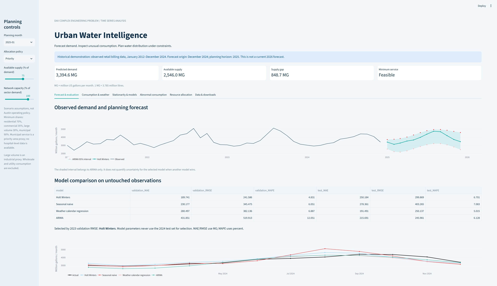
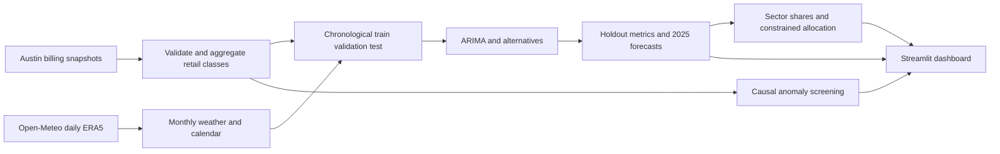

# Urban Water Consumption Forecasting and Smart Resource Allocation

A complete DAV Complex Engineering Problem project with reproducible Python analysis, an interactive Streamlit dashboard, constrained allocation scenarios, tests and a college-format report.



## Quick start

Requires Python 3.12 (64-bit). Run these commands from the repository folder:

```powershell
python -m venv .venv
.venv\Scripts\Activate.ps1
python -m pip install -r requirements.txt
python -m src.pipeline
python -m unittest discover -s tests -v
python -m streamlit run app.py --global.developmentMode false --browser.gatherUsageStats false
```

Open the local URL printed by Streamlit. The committed results allow the dashboard to run without rerunning the pipeline or accessing the internet. Rebuilding the report additionally requires the supplied report template path; the finished report is in `docs/CEP_Report.docx`.

## Evidence and scope

- 26,819 residential and 35,065 commercial source records from City of Austin public data; source snapshots extend from January 2012 through October 2025.
- Analysis intentionally uses 156 complete calendar months, January 2012–December 2024, to make training, validation and testing comparable over full seasonal cycles.
- Training: 2012–2022. Validation: 2023. Untouched test: 2024. Forecast: January–December 2025 from a December 2024 origin. **This is a historical demonstration, not a live 2026 forecast.** Records after the analysis cutoff are not used.
- Residential, commercial, large-volume and municipal retail classes are included. Large-volume consumption is an **industrial proxy**, not verified industrial end-use. Wholesale and Austin Water Utility classes are excluded to avoid potential double counting. Billing records approximate consumption; billing timing can differ from physical water use.
- Real supply capacities, hydraulic constraints and critical-facility locations are unavailable. Minimum-service shares, network capacities and priority weights are explicit **scenario assumptions**, not Austin operating policy. Municipal accounts are a priority-area proxy; hospitals cannot be separately identified.
- Source data contains no exact duplicate records and no missing sector months. Two negative source rows are retained as billing adjustments; monthly aggregates are checked for nonnegative values. Unusual but valid demand is retained, not automatically deleted.

## Results

| Model | Validation RMSE (MG) | Test MAE (MG) | Test RMSE (MG) | Test MAPE (%) |
|---|---:|---:|---:|---:|
| Holt–Winters | 241.59 | 250.18 | 299.87 | 6.70 |
| Seasonal naive | 345.47 | 278.36 | 403.26 | 7.08 |
| Weather/calendar regression | 382.14 | 191.49 | 250.14 | 5.01 |
| ARIMA (2,1,2) | 519.91 | 215.69 | 245.98 | 6.13 |

Holt–Winters is selected using validation RMSE. ARIMA happens to have the lowest test RMSE, but selecting it after inspecting that test would compromise the holdout. The weather/calendar model has the lowest test MAPE. These differences show uncertainty in model rankings across years.

MG means million US gallons per month; 1 MG is approximately 3.785 million litres. MAPE excludes zero actual values; the evaluated months all have positive demand. No forecast accuracy is fabricated.

The ADF p-value is 0.9434 on training levels and 1.12e-16 after first differencing. ACF/PACF exploration and a converged 3×3 p,q grid select ARIMA (2,1,2) by training AIC. Numerical fitting uses billion-gallon scaling and up to 1,000 iterations, with a Powell retry if needed. ARIMA residual Ljung–Box p=0.0341 at lag 12 suggests remaining seasonal dependence. Four months are flagged by the causal anomaly screen; causes are unverified.

## Eight task mapping

| Required task | Implementation and evidence |
|---|---|
| Data collection and cleaning | `data/raw/`, `src/pipeline.py`, `results/data_manifest.json`, `results/summary.json` |
| Exploration | Sector chart, STL decomposition, weather plots and monthly summaries |
| Stationarity | 12-month rolling mean/variance, training-only ADF, `acf_pacf.png` |
| ARIMA and alternatives | ARIMA grid, Holt–Winters, seasonal naive, weather/calendar regression |
| Forecast and evaluate | `metrics.csv`, `test_predictions.csv`, `future_forecast.csv` |
| Abnormal consumption | `anomalies.csv`, causal robust seasonal residuals |
| Resource allocation | `src/allocation.py`, two policies, three supply levels, network caps and infeasibility checks |
| Decision support | `app.py`, six dashboard tabs, interactive controls and CSV downloads |

## Architecture



## Allocation

For sector demand D, allocation x, capacity C and supply S:

`maximize sum(weight[i] * x[i])`, subject to `sum(x) <= S` and `minimum_fraction[i] * D[i] <= x[i] <= min(D[i], C[i])`.

Minimum shares are residential 70%, commercial 35%, large volume 30% and municipal 90%; weights are 4, 2, 1 and 5. The proportional alternative distributes remaining supply according to eligible demand above floors. When floors are infeasible, the program labels an emergency fallback and reports each minimum-service violation. It never describes that fallback as a feasible solution.

The saved scenarios cover 110%, 75% and 35% supply, with sector capacity multipliers 1.10, 0.95, 0.90 and 1.00. Interactive controls allow other capacities. Even ample aggregate supply can leave shortfalls when sector capacity is limited.

## Data attribution and reproducibility

- [Austin Water residential consumption](https://data.austintexas.gov/d/sxk7-7k6z), City of Austin. Public Domain per included metadata.
- [Austin Water commercial consumption](https://data.austintexas.gov/d/5h9c-wmds), City of Austin. Public Domain per included metadata.
- [Historical weather by Open-Meteo](https://open-meteo.com/en/docs/historical-weather-api), ERA5 reanalysis, CC BY 4.0. Daily values for Austin at 30.2672, -97.7431 are transformed into monthly mean temperature and rainfall sums.
- [statsmodels API](https://www.statsmodels.org/stable/api.html) and [Forecasting Principles and Practice](https://otexts.com/fpp3/) explain the forecasting methods.

See `DATA_SOURCES.md` for exact URLs and `results/data_manifest.json` for snapshot SHA-256 hashes. `docs/METHODOLOGY.md` explains leakage controls and limitations. The code license does not override data or college-template rights.

## Project structure

```text
app.py                  Interactive dashboard
src/pipeline.py         Cleaning, exploration, forecasting, evaluation, exports
src/allocation.py       Capacity and minimum-service allocation
tests/                  Automated tests
data/raw/               Original public snapshots and metadata
data/processed/         Joined monthly modeling table
results/                Metrics, predictions, anomalies and scenario exports
results/figures/        Generated analysis plots
docs/                   Report, demonstration screenshots and guides
```

## Before submission

Fill the group/faculty/member/date fields and actual team contributions in the report. Review the assumptions with the teacher and submit the repository link through the required channel. A walkthrough is in `docs/DEMO_GUIDE.md`.
